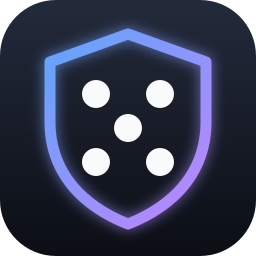
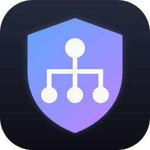
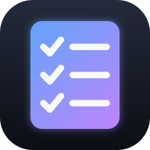
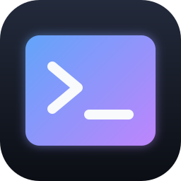
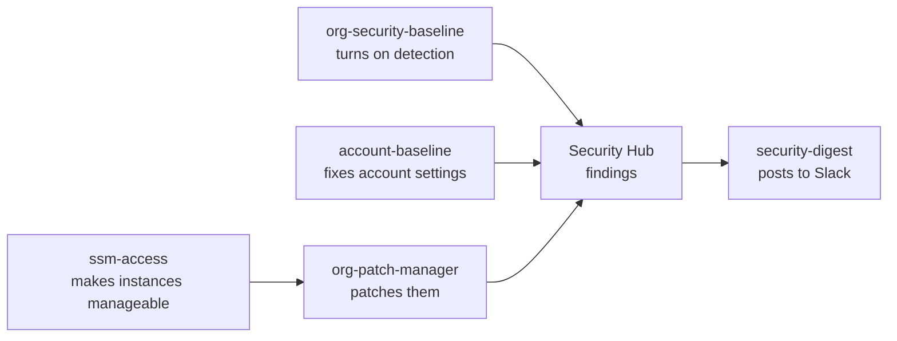

# aws-security-toolkit

**Five small tools that take an AWS organization from default settings to monitored, patched and hard to tamper with.**

 

The daily digest from security-digest, previewed in a terminal with sample findings.

## 🧩 The modules

This repo is the index. The code lives in the five repos below, and you can use any one of them without the others.

| | Module | What it does |
|---|---|---|
|  | [org-security-baseline](https://github.com/simar-s2/org-security-baseline) | Turns on audit logs and threat detection in every account, and keeps the logs where those accounts can't touch them |
|  | [account-baseline](https://github.com/simar-s2/account-baseline) | One command to fix the settings Security Hub flags on every new account |
|  | [org-patch-manager](https://github.com/simar-s2/org-patch-manager) | Patches EC2 instances in every account, with a tag deciding which ones may reboot |
|  | [ssm-access](https://github.com/simar-s2/ssm-access) | Reach instances with no open ports and no SSH keys stored on them |
|  | [security-digest](https://github.com/simar-s2/security-digest) | Posts a daily summary of security findings to Slack |

Each one comes as a Terraform module and as CloudFormation with a one-command deploy script.

## 🔬 How they fit

The full picture, across every account: [docs/DESIGN.md](docs/DESIGN.md).

## ⚡️ Run it

You need an AWS organization with a management account, a log-archive account and a security tooling account. Deploy in this order:

1. [org-security-baseline](https://github.com/simar-s2/org-security-baseline#run-it), across those three accounts.
2. [account-baseline](https://github.com/simar-s2/account-baseline#run-it), from the management account, to cover every account.
3. [ssm-access](https://github.com/simar-s2/ssm-access#run-it), in each workload account.
4. [org-patch-manager](https://github.com/simar-s2/org-patch-manager#run-it), from the management account.
5. [security-digest](https://github.com/simar-s2/security-digest#run-it), in the security account.

## 💰 Cost

GuardDuty, Security Hub and AWS Config are the paid parts, billed per account and region. GuardDuty and Security Hub each start with a 30-day free trial, which shows your real numbers before you commit. The other modules cost little.

## 🧪 How it's tested

`make test` in any module runs against a mocked AWS, so it needs no account and costs nothing. Linters and security checks run in CI. These tests check the code's logic, not how real AWS responds, so try a module in a test organization first.

## 📄 License

[MIT](LICENSE)
