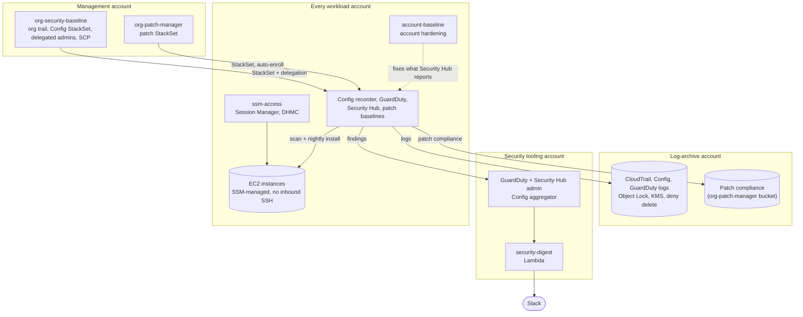

# Design notes

How the five modules fit together across an AWS organization, the conventions they share, and what they cost.

## Architecture

**How the pieces fit:**

- **org-security-baseline** turns detection on everywhere and stores the evidence where the accounts being watched can't change it.
- **account-baseline** fixes the per-account findings that Security Hub raises as soon as the baseline is on.
- **ssm-access** makes every instance reachable without SSH keys and managed by Systems Manager (Default Host Management Configuration), which is what **org-patch-manager** needs to scan and patch them.
- **security-digest** reads the aggregated findings, including patch health from org-patch-manager, and posts them to Slack every morning.

Each concern lives in exactly one module, and the others link to it instead of repeating it:

| Concern | Lives in |
|---|---|
| Log-archive buckets and KMS key | org-security-baseline |
| Patch compliance bucket (deployed into the log-archive account) | org-patch-manager |
| The `patch-reboot` tag and tagging existing instances | org-patch-manager |
| Making instances SSM-managed (instance profile, DHMC) | ssm-access |
| Per-account settings (EBS encryption, public access blocks, password policy) | account-baseline |
| Organization trusted access for the security services | org-security-baseline (`scripts/enable-trusted-access.sh`) |

## Conventions

Every module repository follows the same layout, so moving between them is predictable:

- **Two deploy paths.** A Terraform module (AWS provider 6) with `examples/`, and CloudFormation templates with a `scripts/deploy.sh` that deploys everything in one command.
- **One `name_prefix`** (default `sec`) in front of every resource name, so the toolkit can live next to existing resources.
- **Tested without an AWS account.** `terraform test` against mocked providers, and pytest suites that run the scripts against a fake AWS CLI and the Lambda code against an in-memory Security Hub. `make test` never calls AWS.
- **The same CI everywhere.** GitHub Actions run `terraform fmt` and `validate`, `terraform test`, tflint (with the AWS ruleset), cfn-lint, checkov and shellcheck. Every checkov exception is skipped inline, next to the resource, with the reason.
- **A terminal recording** of each module in its README, made with [vhs](https://github.com/charmbracelet/vhs).

## Cost

GuardDuty, Security Hub and AWS Config, all turned on by org-security-baseline, are paid services billed per account and region; GuardDuty and Security Hub each start with a 30-day free trial, which shows your real numbers before you commit. The other modules cost little: account settings, Patch Manager, Session Manager and Instance Connect are free, and the rest is S3 storage, KMS keys, CloudWatch Logs and a Lambda function that runs once a day. Each README has a cost section with the details.
